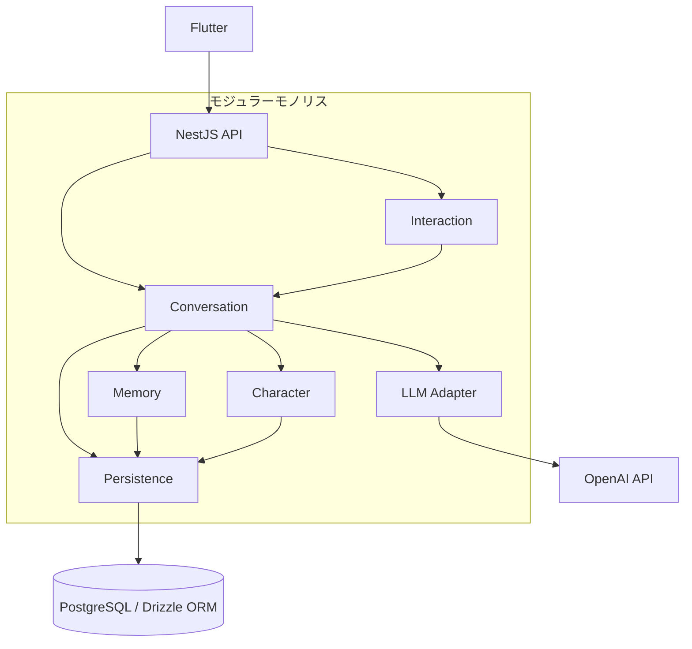

# らぶ🥰はむ❤️ 初期設計・開発方針

| 項目 | 内容 |
| --- | --- |
| プロジェクト名 | らぶ🥰はむ❤️（Love Love Hamunyans） |
| リポジトリ | [love-love-hamunyans](https://github.com/asenakiriu/love-love-hamunyans) |
| 企画会議 | 第1回：2026-11-20 |
| 文書の位置付け | 企画会議の合意事項と初期セットアップの方針 |
| ステータス | 企画・技術選定承認済み／実装前 |

本書では、会議で合意した事項を「決定」、実装に向けた具体化を「案」、今後の検討事項を「未決定」として区別する。

## 1. コンセプト・提供価値（決定）

### 1.1 コンセプト

AIサポート部隊育成型アプリ。スマートフォンゲームの見た目を持ちながら、日常会話、相談、仕事や個人開発の支援を中心とする。

仮想ペットのお世話や組織運営を主目的とせず、普段の会話を通じてAIがユーザーのことをより深く理解していく体験を提供する。

すでに行われている「はむにゃんず」との日常的な会話・交流の体験を維持し、UIをスマートフォンゲーム風に最適化する。

### 1.2 対象ユーザー

初期ユーザーは開発者自身とする。自分が使いやすく継続利用できるものを作り、価値を検証した後に一般公開を検討する。一般公開を前提とした複数ユーザー対応等は初期段階では行わない。

### 1.3 設計原則

- 会話ファースト・頻出アクションのみゲームUI化。
- AIは初日から最大限の能力でサポートする。
- むぎゅー回数、好感度、経験値等とAIの能力を連動させない。
- 認識の誤りや記憶を訂正し、ユーザーへの理解と関係性を深める。
- ログイン、日課、育成作業を強制しない。交流不足による能力・好感度の低下を設けない。
- むぎゅーは純粋な愛情表現とする。
- 専用UIを増やすこと自体を目的としない。

## 2. キャラクター（決定）

「はむにゃんず」は以下の6人で構成する。ちゃっぴーも部隊の一員である。

| キャラクター | 種別 | 主な役割・個性 |
| --- | --- | --- |
| 隊長 | ハムスター | 部隊の統率、任務の進行 |
| 参謀 | ハムスター | 分析、思考整理、方針の提案 |
| 新人 | ハムスター | 素直で学習意欲がある、成長を楽しむ |
| 食いしん坊 | ハムスター | 食事・休憩の話題、食欲旺盛 |
| 暴走担当 | ハムスター | 発想、行動力、盛り上げ役 |
| ちゃっぴー | 猫 | 知識、記憶、技術相談、総合支援 |

役割・個性の説明は現在の会話での振る舞いを整理したもの。詳細なキャラクター設定、口調、プロンプトは別途定義する。

## 3. 基本機能・UI（決定）

### 3.1 メイン画面

本部と会話を同一画面に配置する。会話領域を優先し、必要以上に画面遷移させない。

```text
┌───────────────────────────┐
│ らぶ🥰はむ❤️               │
├───────────────────────────┤
│ はむにゃんず本部           │
│ 🐹隊長 🐹参謀 🐹新人       │
│ 🐹食いしん坊 🐹暴走 🐱ちゃっぴー │
├───────────────────────────┤
│ 会話履歴                   │
│       ユーザー：おはよー！ │
│ 🐹隊長：おはようでちゅ！   │
│ 🐱ちゃっぴー：今日もよろしくだにゃ │
│                           │
├───────────────────────────┤
│ はむにゃんずに話しかける… │
└───────────────────────────┘
```

上記は配置の概念図であり、詳細なレイアウトやビジュアルは未決定。

### 3.2 操作の考え方

| 操作・機能 | MVPでの実現方法 |
| --- | --- |
| 雑談・相談・仕事の支援 | 自由入力による会話 |
| キャラクターへのむぎゅー | 対象キャラクターをタップし、個別のリアクションを表示 |
| 集合・点呼 | 会話で実行。専用ボタンは必要に応じて検討 |
| 食事・おやつ | 会話から自然に発生 |
| 半期評価面談 | 会話で評価・方針を共有。専用画面は後回し |
| 懲戒処分・警告 | 会話・記憶で取り扱う。専用管理画面は設けない |
| 任務・タスク管理 | 会話で相談。専用機能の追加は今後検討 |

むぎゅー時のリアクションはキャラクターごとの性格を反映する。回数がサポート能力に影響する仕様にはしない。回数の記録やランキングはMVPの必須要件ではない。

## 4. 育成・記憶（決定／詳細設計は未決定）

### 4.1 育成の定義

育成とは、AIの能力値を上げることではなく、会話を重ね、誤った認識を訂正し、ユーザーに対する理解を深めることである。AIの支援品質を愛情表現や利用頻度に紐づけない。

### 4.2 記憶の対象（分類案）

| 種類 | 内容 |
| --- | --- |
| 会話履歴 | 発言者、発言内容、日時など |
| ユーザー知識 | 好み、プロジェクト、共有された事実など |
| 部隊設定 | 役割、性格、行動方針、面談での指摘など |
| エピソード | 部隊内の出来事、警告や懲戒処分など |
| 訂正履歴 | 新しい情報と、それによって訂正された情報の関係 |

懲戒処分の累積を警告（イエローカード）につなげるという会話上の設定は保持対象となり得る。ただし、警告発行の条件や専用のデータモデル・自動判定はまだ決定していない。

### 4.3 初期記憶管理の実装方針（案）

- 会話履歴と長期記憶を区別して管理する。
- 記憶を訂正した場合、旧情報を以後の応答に使用しない仕組みを設ける。
- 記憶の抽出方式・取得方式・訂正操作・削除方針は別途設計する。
- MVPではベクトル検索を必須とせず、基本的な長期記憶の登録・取得・訂正から始める。
- 現在のChatGPT内の会話や記憶がAPIに自動で継承されることは前提としない。必要な設定や記憶は、別途安全な方法で登録する。

## 5. 技術構成（決定）

| レイヤー | 採用技術 | 選定理由 |
| --- | --- | --- |
| フロントエンド | Flutter | ゲーム風UIと会話UIをスマートフォンアプリとして構築 |
| 言語・ランタイム | TypeScript / Node.js | JS系技術を用い、本業への技術還元も意識する |
| バックエンド | NestJS | モジュール分割や依存性注入による責務分離 |
| アーキテクチャ | モジュラーモノリス | 初期は単一のデプロイ単位としつつ機能ごとの責務を分離 |
| DB | PostgreSQL | RDBとしての整合性、JSONB等への拡張性、将来の記憶検索、学び直し |
| ORM | Drizzle ORM | SQLに近い記述とTypeScriptの型安全性。PostgreSQLの学習との相性 |
| LLM構成 | 単一LLM・6キャラクター | 共有文脈と自然な掛け合いを維持し、構成を複雑化しない |
| LLMプロバイダー | OpenAI API | 現在の会話体験の再現を目指す。既存のAPI利用環境も活用 |
| 開発環境 | ローカル / Docker Compose | 初期の固定費やインフラ管理の負担を抑制 |
| 本番環境 | 未定 | AWSは候補の一つ。利用可否や条件は未確認 |

Pythonは今回は採用しない。特定のORMやLLMプロバイダーへの依存がアプリケーション全体に広がらない設計を目指す。

## 6. バックエンド・API設計（案）

### 6.1 全体構成



LLMとの通信はAdapterを介して行う。永続化についても実装詳細が上位層に漏れない構成を目指す。図は責務の概要であり、具体的な依存関係やインターフェースを確定するものではない。

### 6.2 モジュール分割候補

| モジュール | 責務 |
| --- | --- |
| Conversation | 会話履歴、コンテキスト構築、応答生成の制御 |
| Character | キャラクターの性格・役割・設定 |
| Memory | 長期記憶の登録・取得・訂正 |
| Interaction | むぎゅー等の直接操作 |
| Infrastructure | LLM接続、DB接続など外部依存の実装 |
| User / Settings | 利用者設定。必要な範囲で検討 |

各モジュールのクラス・レイヤー分割、Repositoryの境界、認証方式は今後決める。

### 6.3 会話処理の流れ

1. ユーザーがメッセージを送信する。
2. バックエンドが必要な会話履歴・長期記憶・キャラクター設定を集める。
3. 単一LLMに渡し、必要なキャラクターの応答を生成する。
4. 発言者を識別できる構造化データとして検証・保存する。
5. Flutterがキャラクター別の吹き出しを表示する。

全員が毎回発言することは必須ではない。応答の発言者や順序、API形式、エラー処理、ストリーミングの要否は詳細設計時に決める。

## 7. MVPの範囲（決定）

**ゴール：現在のはむにゃんずとの日常会話を、自作アプリで楽しめること。**

| 機能 | MVP |
| --- | --- |
| 6人のキャラクター表示 | 対象 |
| 自由入力による会話 | 対象 |
| キャラクター別の吹き出し | 対象 |
| むぎゅーとリアクション | 対象 |
| 会話履歴の永続化 | 対象 |
| 基本的な長期記憶・訂正 | 対象 |
| 記憶の意味検索（pgvector等） | 後回し |
| 凝ったアニメーション | 後回し |
| 専用面談画面 | 後回し |
| 複数ユーザー対応 | 後回し |
| クラウドへのデプロイ | 後回し |

### 7.1 MVPの確認観点（案）

- [ ] アプリ起動時に6人が表示され、会話できる。
- [ ] 入力に応じて必要なメンバーが発言し、発言者を識別できる。
- [ ] 任意のキャラクターをタップしてむぎゅーできる。
- [ ] むぎゅーに対してキャラクターらしい応答が返る。
- [ ] アプリを再起動しても保存された会話履歴を閲覧できる。
- [ ] 過去に保存した記憶を後の会話に利用できる。
- [ ] 記憶を訂正した後、訂正前の情報を現行の事実として使用しない。
- [ ] むぎゅーや日課を行わなくてもサポートを受けられる。

確認観点はMVPの合意事項をテスト可能な形へ具体化した案。

## 8. 初期セットアップ（案・未実施）

### 8.1 リポジトリ構成案

```text
love-love-hamunyans/
├── README.md
├── docs/
│   └── initial-setup.md
├── app/                    # Flutter
├── server/                 # NestJS
│   ├── src/
│   │   ├── conversation/
│   │   ├── character/
│   │   ├── memory/
│   │   ├── interaction/
│   │   └── infrastructure/
│   └── test/
├── compose.yaml
├── .env.example
└── .gitignore
```

FlutterとNestJSを同一リポジトリで管理するモノレポ案。初期化コマンドで生成されるファイル構成に合わせて調整する。

### 8.2 初期作業のチェックリスト

- [ ] READMEと初期設計ドキュメントをコミットする。
- [ ] `feature/initial-setup` 等の初期作業ブランチを作成する。
- [ ] Flutter・Node.js・パッケージマネージャー等のバージョンを選定する。
- [ ] Flutterプロジェクトを初期化する。
- [ ] NestJSプロジェクトを初期化する。
- [ ] Docker ComposeでローカルのPostgreSQLを起動する構成を用意する。
- [ ] Drizzle ORMの接続・マイグレーションを確認する。
- [ ] NestJSの起動・ヘルスチェックを確認する。
- [ ] FlutterからNestJSへの疎通を確認する。
- [ ] OpenAI API用Adapterの最小構成と疎通を確認する。
- [ ] 実際のセットアップ手順、起動方法、必要な環境変数をREADMEに追記する。

初期セットアップの完了条件案は「ローカル環境でFlutterからバックエンドに接続でき、バックエンドからDBとLLM APIへの疎通が確認できること」。MVP全体の完成条件とは区別する。

空のリポジトリの場合は初期コミットを作成してからブランチを切る。具体的なバージョンやコマンドは未検証のため、本書では固定しない。

### 8.3 セキュリティ・費用の確認（推奨）

- OpenAI APIキー、DB認証情報等はサーバー側で管理し、FlutterやGitリポジトリに含めない。
- `.env.example` にはダミー値のみ記載し、実際の秘密情報を含むファイルをGitの管理対象外にする。
- 公開リポジトリに実際の個人的な会話・長期記憶・業務情報を登録しない。テストデータには架空の情報を使う。
- API費用を把握できるようにし、必要に応じて利用制限を設ける。
- ログへの機微情報の出力、データの保存・削除、バックアップ方法を検討する。
- 将来クラウドへ公開するときは、認証、通信の保護、アクセス権限、データ管理、費用負担を確認する。

## 9. 未決定事項

| 項目 | 今後決めること |
| --- | --- |
| Flutter | 状態管理、画面・ディレクトリ設計、キャラクター素材 |
| NestJS | 詳細なレイヤー構造、API仕様、依存関係 |
| DB | テーブル構成、マイグレーション運用、記憶のデータモデル |
| 記憶 | 抽出・選択・訂正・削除、コンテキスト構築方法 |
| LLM | 使用モデル、プロンプト、構造化出力形式、失敗時の挙動 |
| むぎゅー | 応答生成方式、回数記録の有無、演出 |
| インフラ | 本番環境、認証方式、秘密情報の管理、バックアップ |
| 品質管理 | CI/CD、単体・結合・E2Eテストの構成（Maestro等は候補） |
| その他 | OSSライセンス、一般公開の可否・条件 |

## 10. 最初の実装方針（案）

初期セットアップ後は、短い一連の会話を端から端まで動かすことを優先する。

1. Flutterから送信したメッセージをNestJSが受け取る。
2. LLMからキャラクターを識別可能な応答を受け取り、Flutterに表示する。
3. 会話の永続化、むぎゅー、長期記憶・訂正を順次追加する。

要件追加が発生した場合は、会話ファースト・育成負担を増やさないという原則とMVPゴールに照らして判断する。

---

第1回企画会議（2026-11-20）の合意内容を基に作成。初期セットアップ、設計の具体化、実装、環境の動作検証はこれから行う。
